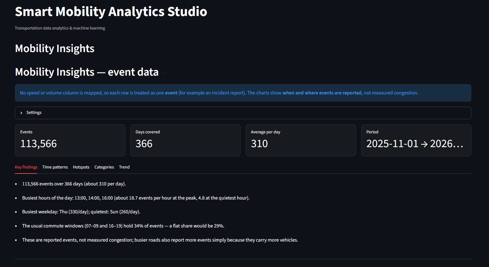
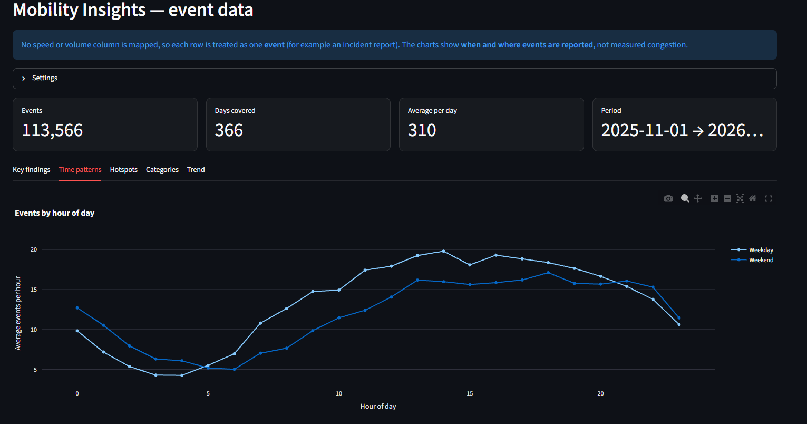
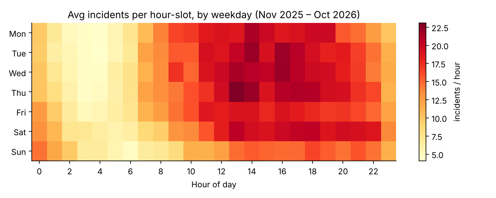
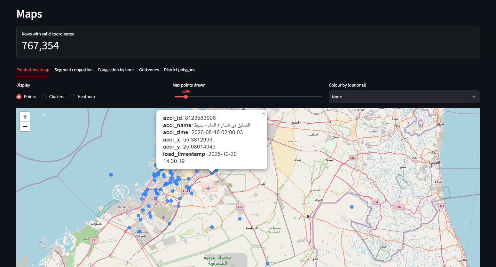
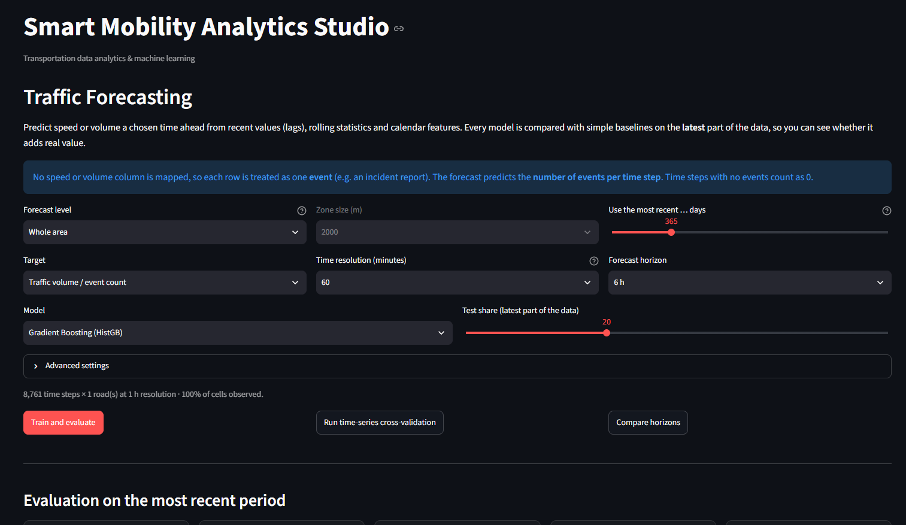

# 🚦 Smart Mobility Analytics Studio

An interactive Streamlit app for cleaning, exploring, mapping and forecasting transportation data:
road-sensor speeds and volumes, GPS trajectories, and event records such as incident reports.

**[▶ Live demo](https://smartmobility.streamlit.app)** · **[Case study: Dubai incidents](docs/CASE_STUDY.md)**



> **Note on data:** the bundled sample data is **synthetic (simulated)** and only demonstrates the app.
> The Dubai case study uses real Dubai Police incident records from Dubai Pulse, which are **not** included in this
> repository (access requires a request and no licence is stated), so you must request them yourself.

<<<<<<< HEAD
## Why I built it

Open mobility data is messy: columns are named inconsistently, coordinates are swapped, load times are mistaken for event
times, and "traffic" files often contain reports rather than measured speeds. This app detects those problems, helps fix them,
and then answers practical questions: *when* and *where* are roads under stress, and can the pattern be forecast?

=======
>>>>>>> a55b07c705811a0679a6fd7e0ad6d671145460e3
## What it does

| Page | What you get |
|---|---|
| Overview / Data Quality / Explorer | Auto column detection, quality profile and score, interactive charts |
| Data Cleaning | Smart cleaning (duplicates, bad or swapped coordinates, impossible values, gaps) with undo and a log |
| **Mobility Insights** | *Sensor data:* peak hours, congestion index, reliability, segment ranking, speed–flow capacity, anomaly-based incidents. *Event data:* events by hour and weekday, hotspot zones, categories, monthly trend |
| **Trips & OD** | Stops and trips from GPS traces, GPS-glitch removal, origin–destination flows |
| **Maps** | Points, heatmap, congestion-coloured segments, hourly animation, grid zones, district choropleth |
| **Forecasting** | Speed, volume or **events per hour** with lag/rolling/calendar features, several models, 4 baselines, prediction intervals, time-series CV, horizon comparison |
| Report & Export | HTML report (print to PDF), CSV, Excel, Parquet |

## Screenshots

| | |
|---|---|
|  |  |
|  |  |

## Example findings (Dubai Police incident records, last 12 months to 1 Nov 2026)

- About **310 reported incidents per day**; busiest hours **13:00, 14:00 and 16:00**; Thursday busiest, Sunday quietest.
- Commute windows (07–09 and 16–19) hold 34% of incidents against 29% if spread evenly: a mild lean, not a sharp rush-hour peak.
- **Data issue found and handled:** before about February 2026 the `acci_x` / `acci_y` columns are swapped (about 686k rows). The app detects and optionally repairs this; without it, older incidents map to the wrong place.
- **Forecast:** hourly whole-area incident counts were **not** predicted better than a "typical weekday-hour profile" baseline (about 3.5% worse). Hour and weekday explain most of the pattern.

*These are reported incidents, not measured congestion. Busier roads also report more incidents simply because they carry more vehicles.*

## Method notes

- **Congestion index** = 1 − speed / free-flow speed (free-flow = 85th percentile of each road's speed).
- **Planning time index** = free-flow speed ÷ 5th-percentile speed (reliability).
- **Anomalies**: speed compared with that road's typical value for the same weekday and hour (robust z-score or IsolationForest); consecutive flags merge into one incident.
- **Leakage-aware forecasting**: chronological split with a purge gap equal to the horizon; every model is scored against persistence, seasonal-naive, typical-profile and train-mean baselines on the same rows. "Skill" is the improvement over the best baseline and can be negative.
- **Prediction intervals** are empirical and constant-width, not per-point.
- **Event mode**: with no speed or volume column, each row counts as one event; empty hours count as zero.
- **Stops and trips** depend on GPS sampling rate; thresholds are adjustable.

## Run locally

```bash
python -m venv .venv
source .venv/bin/activate          # Windows: .venv\Scripts\activate
pip install -r requirements.txt
streamlit run app.py
```

Then load a sample from the sidebar or upload CSV / Excel / Parquet / ZIP.

## Test

```bash
pip install -r requirements-dev.txt
python -m pytest -q
```

`tests/test_pages_smoke.py` runs every page against a stubbed Streamlit to catch Python errors.
It does **not** check visual layout.

## Project layout

```
app.py                      entry point
views/                      one module per page
mobility/                   logic without Streamlit: detection, quality, insights, trips, forecasting, geo, mapping, report, dataio
config/field_aliases.json   add your own column-name aliases without touching code
tests/                      pytest suite
docs/                       case study, dataset notes, images, screenshots
scripts/make_sample_data.py regenerates the synthetic samples
```

<<<<<<< HEAD
## Limitations

- Samples are simulated. The Dubai case study analyses reported incidents, not speeds or flows, and the source states no licence.
- The congestion and reliability analysis has so far been tested only on synthetic road-sensor data.
- Forecast intervals are constant-width; weather, holidays and events are not used as features.
- Swap repair assumes the newest records have the correct column order; check the map afterwards.
- Very large files: install `pyarrow` and `duckdb`, and prefer Parquet.

## Data

See [docs/DATASETS.md](docs/DATASETS.md). Incident data: Dubai Police via [Dubai Pulse](https://www.dubaipulse.gov.ae/data/dp-traffic/dp_traffic_incidents-open) (permission required).
=======
>>>>>>> 11657e6b62799b1a5b4a5f93d31a128c305ff262
- Samples are simulated; the case-study document is a template you must fill with your own findings.
- Very large files: install `pyarrow` (Parquet) and `duckdb` (fast CSV) and prefer Parquet.
- Logs are written to `logs/app.log`.
>>>>>>> a55b07c705811a0679a6fd7e0ad6d671145460e3
