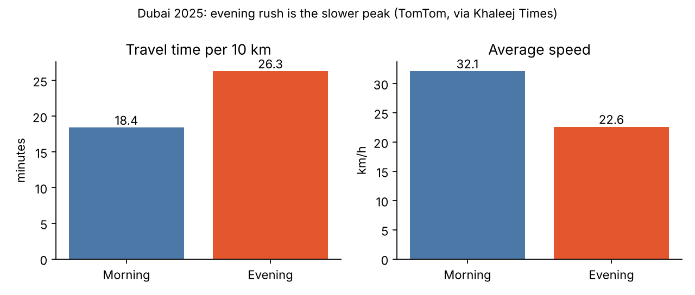
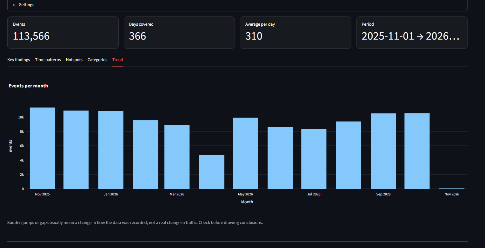
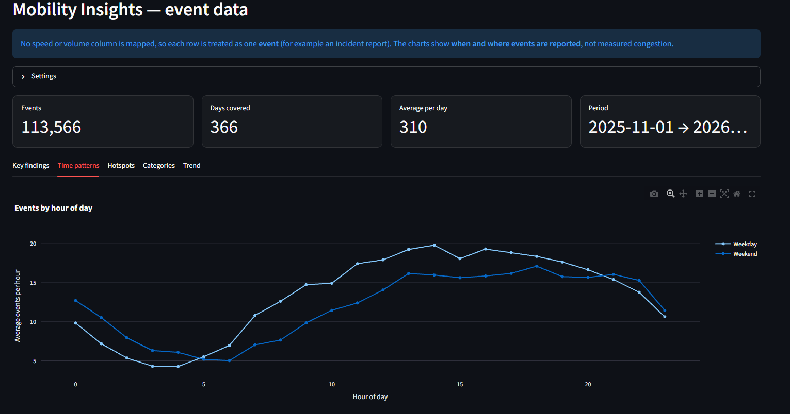
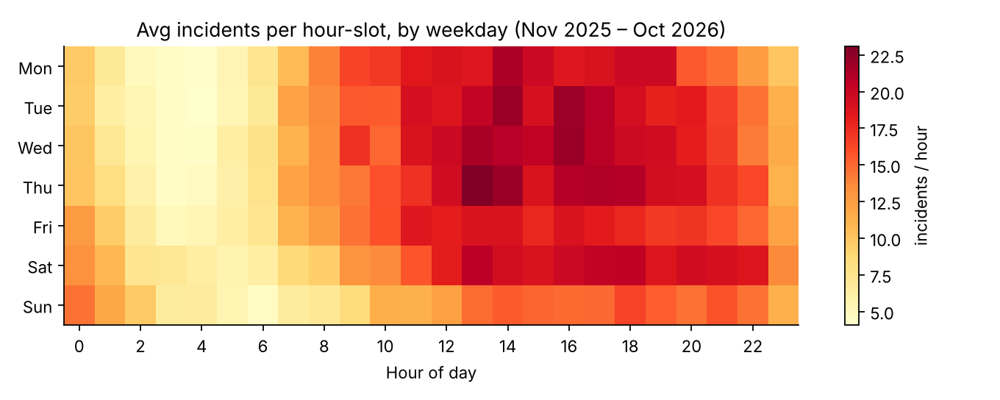
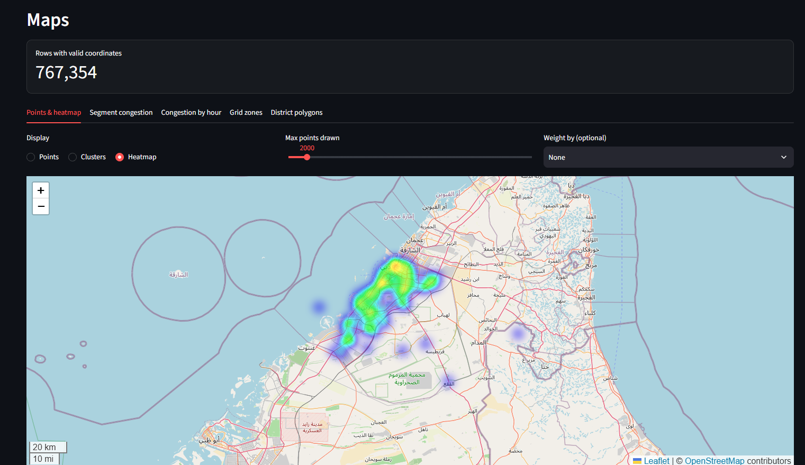

# When and where do road incidents happen in Dubai?

**A mobility case study using Smart Mobility Analytics Studio**

> **What this case study is and is not.**
> Section 2 is a **desk study** of *published* traffic reports and a TomTom-based news summary; I did not measure those numbers.
> Section 3 is my **own analysis** of 767,385 real Dubai Police incident records (Dubai Pulse) using this app.
> The incident records show **where and when incidents are reported, not measured congestion or speed.**
> The app's built-in samples are **simulated** and are never used for the findings below.

---

## 1. Question

1. **When** during the day and week are road incidents reported in Dubai, and does that match the published picture of rush-hour congestion?
2. **Where** are the recurring incident hotspots?
3. How far can open incident data go in answering questions about congestion, and what else would be needed?

## 2. Desk study: what published sources say

### 2.1 When — timing

| Finding | Value | Source |
|---|---|---|
| Typical weekday morning window | 6–10 am, worst about 7–9 am | Blacklane guide |
| Typical weekday evening window | 4–8 pm, heaviest about 5–7 pm | Blacklane guide |
| Average time to drive 10 km, 2025 | 19.1 min (13.7 min in 2024) | TomTom via Khaleej Times |
| Morning vs evening, 10 km | 18.4 min vs **26.3 min** | TomTom via Khaleej Times |
| Morning vs evening average speed | 32.1 km/h vs **22.6 km/h** | TomTom via Khaleej Times |
| Time lost in traffic, 2025 | 72 h per driver (TomTom); about 45 h (INRIX) | Khaleej Times |
| Worst recorded moment | 5 pm, 11 Nov 2025 (168% congestion) | Khaleej Times |

**Takeaway:** the **evening peak is clearly worse** than the morning peak (about 43% longer per 10 km). Different providers measure differently (TomTom 72 h vs INRIX 45 h), so compare trends, not absolute numbers across providers.

*Figure 1 — Drawn from the TomTom figures reported by Khaleej Times (see Sources).*

> Caveat: the Khaleej Times article uses the number 26.3 both for evening minutes per 10 km and for rush-hour average speed in km/h without explanation. I used only the morning/evening pair that is internally consistent (18.4 vs 26.3 minutes; 32.1 vs 22.6 km/h). Check against TomTom's own page before publishing.

### 2.2 Where — recurring hotspots

Gulf News live traffic reports (18 June 2026, morning; 8 September 2026, evening) and the Blacklane guide repeatedly name the same corridors. These are **single-day reports**, not statistics, so treat them as indicative.

| Corridor | Where it is slow | Peak |
|---|---|---|
| **Sheikh Zayed Road (E11)** | Sharjah → Dubai near the Airport/Garhoud; Business Bay to Interchange 3; Marina–Al Barsha–Business Bay toward Defence Roundabout | Morning and evening |
| **Sheikh Rashid Road (D75) / Karama–Bur Dubai** | Karama toward Bur Dubai, near junction with E11 | Morning and evening |
| **Al Khail Road (E44)** | Ras Al Khor ↔ Meydan; Al Quoz; Dubai Hills ↔ Meydan | Morning and evening |
| **Sheikh Mohammed bin Zayed Rd (E311)** | Sharjah → Dubai around Muhaisnah (am); Nad Al Sheba → Muhaisnah (pm) | Morning (inbound), evening (outbound) |
| **Al Safa Street (D71) / Umm Suqeim Street (D63)** | City Walk, Dubai Mall area; Al Sufouh–Al Barsha | Includes school drop-off/pick-up |
| **Business Bay Crossing** | Toward Deira (am), toward Bur Dubai (pm) | Peaks |
| **Emirates Road (E611)** | Mostly smooth; pockets near Tilal / Al Badia interchange | Evening |

**Pattern:** congestion concentrates on the **radial commuter corridors between Sharjah/Ajman and central Dubai** (E11, E311, D75) and the **inner east–west spine** (E11 and Al Khail). Emirates Road is relatively free-flowing in these reports.

### 2.3 Context: supply keeps growing

Per the same report: active registered vehicles reached 4.65 million (Q3 2025) and population passed 4 million in 2025, while average rush-hour speeds fell ~1 km/h year on year and highway speeds ~2.1 km/h. New capacity (e.g. World Trade Centre roundabout bridges, Al Hessa Street lanes, Mall of the Emirates bridge) was opened in 2025.

## 3. Own analysis: Dubai Police incident records

### 3.1 Data

| | |
|---|---|
| Source | *Traffic Incidents*, Dubai Police via [Dubai Pulse](https://www.dubaipulse.gov.ae/data/dp-traffic/dp_traffic_incidents-open) (access by request; licence "not specified") |
| Size / period | 767,385 rows, 13 Aug 2018 – 1 Nov 2026 |
| Fields | incident id, category (Arabic text), incident time, two coordinate columns, a load timestamp |
| Window analysed | **1 Nov 2025 – 31 Oct 2026** (113,325 incidents on 342 days that contain data) |
| Not in the repository | The raw file is not published here because of the access terms. |

The data contains **no speed and no traffic volume**, so the app's congestion index and reliability measures cannot be computed from it. This analysis therefore answers *when and where incidents are reported*, which is a proxy for stress on the road network, not a measure of congestion.

### 3.2 Data-quality findings (what the app caught)

| Issue | Size | Handling |
|---|---|---|
| Exact duplicate rows | 862 (and 4,097 repeated incident IDs) | Removed exact duplicates only; repeated IDs not investigated |
| **Swapped coordinates** | **685,727 rows (89%)**: before about Feb 2026 `acci_x` holds the latitude and `acci_y` the longitude; newer records have x = longitude, y = latitude | Repaired by treating the newest 20% of rows as the reference layout. After repair 99.3% of rows fall inside Dubai |
| Invalid coordinates | about 2,200 rows (zeros or out of range) | Set to missing |
| **Placeholder location** | 956 incidents (2025-26) share the exact point 25.07576°N, 54.94730°E, far from the road network and covering every incident type | Removed from the hotspot ranking; it would otherwise be the single biggest "hotspot" |
| Load time vs event time | `load_timestamp` is when the record was loaded | Not used; the incident time `acci_time` is used |
| Gaps | Oct 2025 (about 5,300 records) and Apr 2026 (about 4,700) are roughly half the usual ~10,000 per month | Kept, flagged; they lower the averages slightly |

*Figure 2: monthly reports. Oct 2025 and Apr 2026 look incomplete.*

### 3.3 When: timing

*Figure 3: average incidents per day by hour (shaded: usual commute windows).*

- Average **331 incidents per day on days with data**.
- Busiest hours **13:00–14:00 (about 20 per hour) and 16:00–19:00 (about 19 per hour)**; quietest 03:00–04:00 (about 5 per hour).
- The usual commute windows (07–09 and 16–19) hold **34% of incidents against 29%** if reports were spread evenly. The pattern is a broad afternoon-to-evening plateau, **not** a sharp 7–9 am / 5–7 pm rush-hour spike.
- Busiest weekday **Thursday (about 350 per day)**; quietest **Sunday (about 280)**. Saturday is about 345, so the Sat–Sun "weekend" label hides a very different Saturday and Sunday.

*Figure 4: average incidents per hour-slot by weekday.*

**What the incidents are.** Grouping the Arabic categories (my keyword grouping; check before quoting):

| Group | Share |
|---|---|
| Vehicle hit a fixed object (pole, wall, barrier, curb) | 35% |
| Vehicle breakdown | 25% |
| Double parking | 9% |
| Collision between vehicles | 8% |
| Violating vehicles | 8% |
| Other | 15% |

Most reports are minor ("بسيط" in the category name means minor) and a third involve a vehicle hitting a fixed object. Breakdowns peak at 16:00–18:00, hit-object reports at 13:00–16:00.

### 3.4 Where: hotspots

*Figure 5: incident density after repairing swapped coordinates and removing the placeholder point. No basemap; open the app's Maps page to see the street layout.*

- The reports trace the shape of Dubai's built-up area and its main roads, which is a useful sanity check on the coordinate repair.
- The densest 1 km squares form a **north–south strip around longitude 55.27–55.28°E between about 25.19°N and 25.23°N** (centres at 25.194, 55.283; 25.201, 55.275; 25.229, 55.274), plus squares near 25.256, 55.334 and 25.275, 55.304. Central Dubai's main corridor runs through this strip, which fits the corridors named in section 2.2, but I have not matched squares to road names. **Check on the Maps page before claiming specific roads.**
- Concentration is moderate: the 10 busiest squares hold only **5.3%** of incidents, and the busiest 5% of squares hold about **30%**.

### 3.5 Forecasting

Hourly whole-area incident counts were forecast with gradient boosting and compared with four simple baselines on a later test period. The model was about **3.5% worse than the "typical weekday-hour profile" baseline** (it did not beat it). Per-zone hourly counts are too small (often 0 or 1) to forecast well.

Interpretation: when incidents are reported is mostly explained by hour of day and weekday. A model needs extra information, such as weather, events or traffic flow, to add value.

### 3.6 Comparing with the published picture

| Question | Desk study (section 2) | Incident data (section 3) |
|---|---|---|
| Peak time | Sharp commute peaks, evening worse | Broad afternoon to evening plateau (13:00 to 19:00); commute windows only mildly over-represented |
| Weekday pattern | Weekday peaks | Thursday highest, Sunday lowest |
| Place | E11, E44, E311, D75 corridors | Central strip around 55.27°E, 25.19 to 25.23°N (road names not yet matched) |

The two sources agree on a busy afternoon and evening and on a central-Dubai concentration. They differ on peak sharpness, which is expected: reports of minor incidents, breakdowns and double parking follow when vehicles are on the road and parked, not when speeds are lowest.

## 4. Limitations

- Part 2 is based on news reports; live reports describe single days.
- Incident counts are not congestion, and busier roads report more incidents because they carry more traffic. No exposure (traffic volume) data was available to normalise them.
- The coordinate-swap repair assumes the newest records have the correct order; the fact that repaired points form Dubai's shape supports this.
- Time zone assumed to be local Dubai time.
- The category grouping is my own keyword rule, not an official taxonomy.
- Two months look incomplete; there may be other undetected gaps.
- The source states no licence.

## 5. Reproduce

1. Request the dataset on Dubai Pulse and upload the CSV in the app.
2. Check the column mapping: timestamp `acci_time`, longitude `acci_x`, latitude `acci_y`, weekend Sat–Sun.
3. Data Quality: apply duplicates, swapped coordinates and invalid coordinates.
4. Mobility Insights shows the timing, hotspot and category views. Maps shows the heat map. Forecasting predicts incident counts per hour.

## 6. Next steps

- Match the hotspot squares to roads and compare them with the corridors in section 2.2.
- Add speed or traffic-flow data to measure congestion directly and run the app's congestion and reliability analysis.
- Normalise incidents by traffic volume, and add weather and calendar (Ramadan, school terms) data.

## Sources

- [Dubai motorists lose nearly 4 days to traffic in 2025 as congestion rises: Khaleej Times](https://www.khaleejtimes.com/uae/transport/dubai-commute-time-increase-2025-more-cars)
- [Dubai morning traffic update: Where roads are busiest during rush hour: Gulf News, 18 Jun 2026](https://gulfnews.com/uae/transport/heading-to-work-dubai-morning-traffic-is-slowing-these-major-roads-1.500578222)
- [Dubai-Sharjah traffic: Where motorists face the worst evening rush-hour delays: Gulf News, 8 Sep 2026](https://gulfnews.com/uae/transport/dubai-sharjah-traffic-where-motorists-face-the-worst-evening-rush-hour-delays-1.500667440)
- [When is Rush Hour in Dubai?: Blacklane](https://www.blacklane.com/en/blog/travel/rush-hour-dubai/)
- [TomTom Traffic Index: Dubai](https://www.tomtom.com/traffic-index/dubai-traffic/)
- [Traffic Incidents: Dubai Pulse / Dubai Police](https://www.dubaipulse.gov.ae/data/dp-traffic/dp_traffic_incidents-open)
